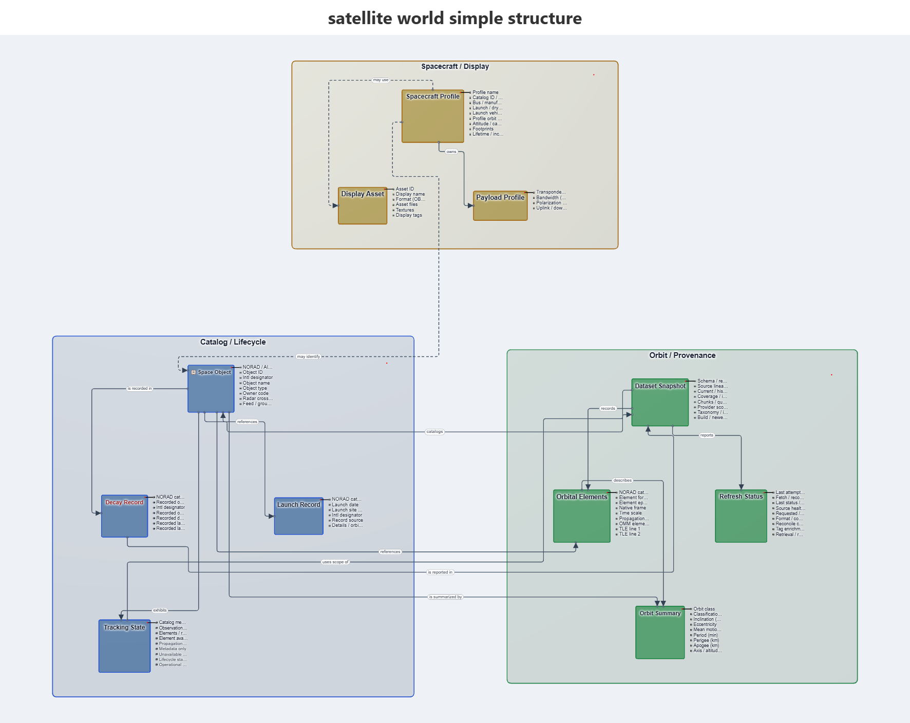
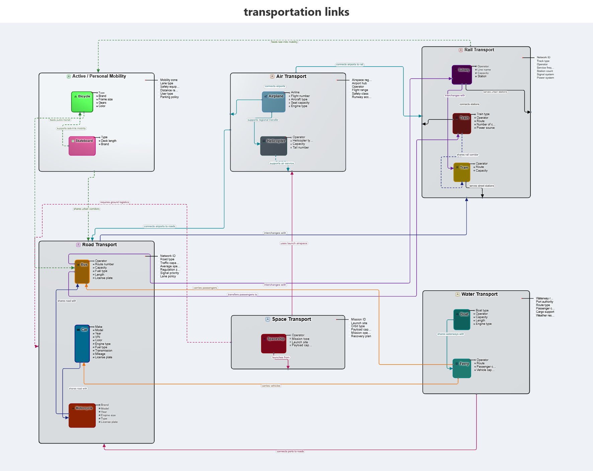

# HBDS Graphic Simulator

Build and explore **Hypergraph-Based Data Structures (HBDS)** in your browser.
Model classes, nested hyperclasses, attributes, and relationships in 2-D or 3-D.

**Version 2.7** · [Downloads and release notes](https://github.com/arcazj/openbexi_hbds/releases/tag/v2.7) · [Live demo](https://arcazj.github.io/openbexi_hbds/index.html)

## Examples

Screenshots recorded in version 2.6.2 show compact attribute
columns and separated links. Viewer controls are hidden for clarity.

### OpenBEXI Timeline

The Timeline domain model connects users, filters, presentation models, sources,
records, namespaces, and shared rendering. [Model and source mapping](doc/OPENBEXI_TIMELINE_MODEL.md)
and [complete application recreation prompt](prompts/openbexi_timeline_prompt.MD).

### Satellite World Simple Structure

A source-audited view of space objects, historical decay records, orbital data,
and dataset provenance. [Model and source mapping](doc/SATELLITE_MODEL_SOURCES.md).



### Transportation Links

Classes and relationships in a transportation network.
[Open the model JSON](models/transportation_links.json).



## Features

- **Models, Edit, Tests, and Query:** browse examples, edit models, run visual scenarios, and query the entire current model.
- **Structural queries:** use 21 canonical legacy functors over classes, hyperclasses, attributes, containment, and links. Browse the full 141-functor reference with source pages and availability. See the [query workflow and mapping](doc/HBDS_SUPPORT_MATRIX.md#structural-query-workspace).
- **Automatic layout:** Grid, Radial, and Hierarchy with nested groups, readable names, and routed links.
- **Link separation:** **Separates links** is on by default; turn it off to use legacy spacing.
- **Attribute columns:** one connector to the first attribute, larger text, and compact spacing adjustable in the 2D attribute inspector.
- **Editing and export:** search the model tree, drag nodes, copy/paste, edit attributes, and export JSON or diagram images.
- **AI support:** generate, validate, and improve models with reviewed changes, selective apply, and rollback. Includes a manual copy/paste workflow.
- **Local collaboration:** share live drafts, review differences, and merge compatible edits through the Python server.
- **Optional semantics:** object instances, inheritance, memberships, and functor queries.

## Quick start

**Windows 10 / 11:** download the [x64 installer](https://github.com/arcazj/openbexi_hbds/releases/download/v2.7/openbexi-hbds-2.7-windows-x64-setup.exe)
or [ARM64 installer](https://github.com/arcazj/openbexi_hbds/releases/download/v2.7/openbexi-hbds-2.7-windows-arm64-setup.exe).
Python and browser libraries are included. The installers are unsigned.
See [installation, data storage, upgrades and removal](doc/WINDOWS_INSTALLATION.md).
Commercial use requires an agreement unless a documented free-use exemption applies.

**Run from source:**

Requires Python 3.9+ and a modern browser. On Windows, use `py` in place of `python3`.

```sh
git clone https://github.com/arcazj/openbexi_hbds.git
cd openbexi_hbds
python3 server.py --port 8010
```

Open **http://127.0.0.1:8010/**. Choose **Models** to browse, **Edit** to work with
`models/`, or **Tests** for `test_models/`. Use **Fit Model**, the mouse wheel to
zoom, and right-click drag to pan. **Help** contains the full user guide.

**Query**, between Tests and Help, uses the selected diagram, including unsaved
edits. Choose a functor and its dynamic inputs; results update automatically.
Use **CONT** for a hyperclass's direct classes, **CONTN** for classes at every nesting
depth, **HCONT** for its direct hyperclasses, and **COUPLE** for directed links between
two classes. Use **Add step** to compose
compatible functors. Query opens in a compact 400-pixel sidebar beside the diagram,
or below it on small screens. The searchable model selector beside **Query** lists
the current session, Models, and Tests. Choosing another model opens a separate
diagram preview; returning to Edit or Tests restores the original session and its
unsaved edits. Compatible functors are retained, model-specific inputs reset, and
results refresh when the inputs are complete. Functor descriptions remain visible
below the selectors as well as in tooltips. Shared compact controls and soft section
colors keep Models, Edit, Tests, Query, and Help consistent. Results show Type, Name, and Locate,
with 25/50/100-row pages.
**Locate** and **Locate all** apply fluorescent yellow text and link highlights
without moving or zooming the diagram. Locate all follows the Results filter
across every page; name tooltips provide identifiers and paths.
Model changes refresh results automatically; Query preserves the editor and its undo history. The connection
indicator and square tree toggle sit together at the upper left.

The server saves models with revision checks and timestamped backups. It binds
to localhost and is intended for a trusted workstation. For viewing and local
JSON downloads without API writes or collaboration, add `--static-only`.

See [server and AI setup](doc/SERVER_AND_AI.md) for credentials, configuration,
collaboration, and API access. Serve the app through `server.py`; opening HTML
files directly does not reliably support its modules and model loading.

## Documentation

- [Modeling tutorial](doc/HBDS_MODELING_TUTORIAL.md) and [HBDS glossary](doc/HBDS_GLOSSARY.md)
- [Layout and optimization](doc/LAYOUT_OPTIMIZATION.md)
- [OpenBEXI Timeline model](doc/OPENBEXI_TIMELINE_MODEL.md) and [recreation prompt](prompts/openbexi_timeline_prompt.MD)
- [Diagram contract](doc/HBDS_STRUCTURAL_DIAGRAM_PROFILE_V1.md) and [JSON schemas](schemas/README.md)
- [Documentation catalog](doc/README.md) and [proposed functor API](openapi_docs/README.md)
- [Testing and integration](Test_and_Integration.md), [roadmap](Roadmap.md), and [open issues](https://github.com/arcazj/openbexi_hbds/issues)

## Development

The browser app uses Three.js, plain JavaScript, HTML, and CSS; the server uses
Python's standard library. Run checks in an isolated copy with Node.js and
Edge or Chrome installed:

```sh
python3 -B scripts/check_project.py
```

Use `--skip-browser` for helper/server checks. Browser dependencies are bundled
locally; AI provider tests use mocks. See the [testing guide](Test_and_Integration.md)
for individual suites. Contributions are welcome through pull requests with
relevant validation results.

## License

**Personal noncommercial use, student and educator activities, academic and
other noncommercial research, and qualifying charities and nonprofits are free.**
Business use requires a paid commercial agreement unless it qualifies for an
exemption under the **Commercial and Exempt Use License**.

See [LICENSE.txt](LICENSE.txt) and [commercial licensing](COMMERCIAL_LICENSE.md).
Licensing contact: [openbexi@gmail.com](mailto:openbexi@gmail.com).
Earlier MIT permissions and third-party terms remain in effect for their
respective material: [MIT notice](LICENSES/MIT-legacy.txt), [third-party notices](THIRD_PARTY_NOTICES.md).
